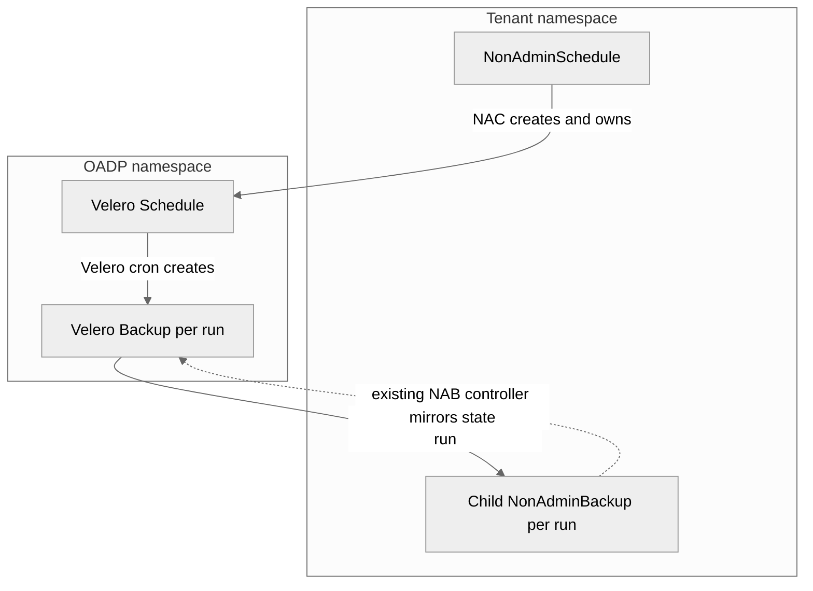

# RFE-9751: NonAdminSchedule

## Abstract

This document describes the `NonAdminSchedule` (NAS) API and controller.
NAS gives a tenant self-service scheduled backups inside its own namespace.
The NonAdmin controller (NAC) validates the schedule template, creates one backing Velero `Schedule` in the OADP namespace, and surfaces every generated Velero `Backup` as a synchronized `NonAdminBackup` (NAB) in the tenant namespace.
Velero stays responsible for cron execution, per backup TTL retention, pause and resume, and skipping the next run.

## Background

A non-admin tenant can already create a one-off backup through `NonAdminBackup`.
Tenants want recurring backups without asking a cluster admin to create a Velero `Schedule` for them.
Velero `Schedule` objects live in the OADP namespace, which tenants cannot access, so NAC must own the backing object and mediate every interaction.

## Goals

- A namespaced `NonAdminSchedule` API that a tenant fully controls in its own namespace.
- Reuse the existing NAB validation, namespace isolation, NABSL resolution, exclusion rules, and DPA enforced backup spec.
- Expose each generated Velero `Backup` as a child NAB so the existing NAB and NAR flows work unchanged.
- Safe coexistence with the periodic `NonAdminBackupSynchronizer` and the `GarbageCollector`.

## Non Goals

- Cross-cluster non-admin restore.
- Individual file restore.
- Tenant control over backing object metadata.

## High-Level Design

The tenant owns the `NonAdminSchedule`.
NAC owns the backing Velero `Schedule` and every label, annotation, and ownership marker on it.
Velero owns cron execution and produces one Velero `Backup` per run.
NAC is the single owner of the generated backups' tenant-facing lifecycle: it creates exactly one child NAB per run and reaps that child when the backing backup is gone.

## Detailed Design

### API

`NonAdminSchedule.spec` contains:

- `schedule`: a standard Velero cron expression.
- `paused`: stops or resumes future executions.
- `skipImmediately`: skips the next scheduled execution. This is an edge trigger and NAC resets it after Velero accepts it.
- `template.backupSpec`: the complete existing Velero `BackupSpec` surface.

Tenant controlled template metadata is intentionally not honored.
Velero copies a schedule template's metadata labels onto every generated `Backup` when they are set, in place of the backing Schedule's own labels, so honoring tenant metadata would let a tenant overwrite the NAC ownership labels that the whole model depends on (see Concurrency and Ownership).
The API exposes the full Velero `BackupSpec`, which embeds `metadata`, so the controller cannot block this structurally.
NAC therefore clears `template.backupSpec.metadata` while building the backing template, which forces Velero to inherit the Schedule's NAC owned labels.

`NonAdminSchedule.status` exposes the backing Velero `Schedule` state, the next calculated run, the latest generated backup, and the five newest generated child backups.

### Backing Schedule naming and the label value budget

NAC allocates a NACUUID for the schedule and uses it as the backing Velero `Schedule` name.
Velero names each generated `Backup` as `<scheduleName>-<timestamp>` where the timestamp is a fixed 15 character suffix (`-20060102150405`, see Velero `schedule_types.go`).
NAC reuses that generated backup name as the value of the `nab-synced-from-nacuuid` and `nab-origin-nacuuid` labels on the child NAB and the backing Backup.
Kubernetes caps a label value at 63 characters.
Therefore the schedule NACUUID must be at most 48 characters (`63 - len("-20060102150405")`) so every generated backup name stays a valid label value.
The default `GenerateNacObjectUUID` caps at 63, which is too long for this case, so NAC must allocate the schedule NACUUID with a 48 character bound while keeping the full UUID portion for uniqueness.

### Validation and template enforcement

On each reconcile NAC builds a throwaway NAB from `template.backupSpec` and runs the same `ValidateBackupSpec` used by `NonAdminBackup`.
This enforces namespace isolation (`includedNamespaces` may contain only the tenant namespace, `excludedNamespaces` is forbidden), forbids cluster scoped escalation, and resolves `storageLocation` to a tenant NABSL that is `Created` and backed by an `Available` Velero BSL.
NAC also rejects an invalid cron expression before creating anything.

After validation NAC builds the backing template:

- Merge DPA enforced backup spec fields into any template field the tenant left empty. Conflicts are already rejected by `ValidateBackupSpec`.
- Force `includedNamespaces` to the tenant namespace.
- Resolve the tenant NABSL name to the real Velero BSL name for the backing object, and record the tenant facing NABSL name in the `nas-origin-storage-location` annotation so child NABs can present the tenant name back.
- Append the always excluded namespaced and cluster resource lists, honoring the same wildcard guards and new-style versus old-style resource filter rules as NAB.

### Backing Velero Schedule lifecycle

NAC creates one Velero `Schedule` named after the schedule NACUUID, labeled with `GetNonAdminLabels()` plus `nas-origin-nacuuid`, and annotated with the origin namespace, origin name, and optional origin storage location.
On update NAC verifies the backing object still points back to this NAS (NACUUID label and origin annotations) before changing it, and rejects a mismatch.
`paused` maps directly to the Velero `Schedule` `paused` field.

`skipImmediately` is an edge trigger.
NAC writes `skipImmediately=true` onto the backing Velero `Schedule`, then resets the tenant field to false at submission time so later reconciles do not re-request a skip.
NAC preserves an already submitted skip on the backing object until Velero clears it, so NAC never cancels a skip the Velero schedule controller has not yet observed.

### Generated backup synchronization

Each reconcile NAC lists the generated Velero `Backup` objects for this schedule (matched by `velero.io/schedule-name` and `nas-origin-nacuuid`), filters out any whose origin annotations do not match this NAS, and for each one:

1. Stamps the backup with its per run NAB identity: `nab-origin-nacuuid=<backupName>` label and `nab-origin-namespace` and `nab-origin-name` annotations.
2. Creates exactly one child NAB named after the generated backup, labeled `nab-synced-from-nacuuid=<backupName>` and `nas-origin-nacuuid=<scheduleNACUUID>`, with the tenant facing NABSL name restored on its spec.

The child NAB travels the existing NAB sync path: because it carries `nab-synced-from-nacuuid`, the NAB controller mirrors the pre-existing Velero `Backup` rather than creating a new one.

### Concurrency and Ownership

This is the load-bearing section.
Velero copies the backing `Schedule` labels onto every generated `Backup`, so generated backups carry `GetNonAdminLabels()` and would otherwise match the selectors of two other controllers:

- The periodic `NonAdminBackupSynchronizer`, which creates a NAB for any completed NAC labeled backup whose origin NAB does not yet exist.
- The `GarbageCollector`, which deletes any NAC labeled backup that carries origin metadata but has no backing NAB.

Without coordination these create two failure modes in the window between NAC stamping origin metadata on a generated backup and NAC creating its child NAB:

- The synchronizer creates the child NAB first, without the `nas-origin-nacuuid` label, so NAC's reaper can never clean it up and the storage location diverges.
- The garbage collector deletes the tenant's generated backup as a presumed orphan.

Ownership rule: a Velero `Backup` that carries both `velero.io/schedule-name` and `nas-origin-nacuuid` is a schedule generated backup and is owned exclusively by the NonAdminSchedule controller.

- The `NonAdminBackupSynchronizer` must skip these backups. It never creates child NABs for schedule generated backups.
- The `GarbageCollector` must skip these backups. Retention is governed by Velero TTL, not orphan collection.
- The NonAdminSchedule controller is the only creator of schedule child NABs and the only reaper of them.

This rule holds whether or not the synchronizer and garbage collector are enabled, which matters because NAS is registered unconditionally while those two are gated on their DPA periods.

The ordering inside the NAS controller is also made race safe: because the synchronizer and GC skip schedule backups, the stamp then create sequence no longer has a destructive window, and a repeated reconcile converges on exactly one child NAB per run.

The invariant that NAS never sets `template.metadata.labels` is explicit and must be covered by a test, because setting it would change which labels Velero copies onto generated backups and would silently break the skip rules above.

### Status

NAC mirrors the backing Velero `Schedule` status, computes `nextRun` from the cron expression and the later of the last backup and last skipped times, and records the five newest generated child backups newest first with their phase and timestamps.
`phase` is a high level summary of the NAS lifecycle, and `conditions` carry acceptance detail.

### Deletion and retention

Deleting a `NonAdminSchedule` deletes the backing Velero `Schedule`, which stops future runs.
Already created child NABs and their Velero `Backup` objects are retained until their TTL expires or the tenant deletes a child NAB.
The backing Schedule does not own the generated backups through owner references, so removing it does not cascade delete history.

Child NAB cleanup must survive `NonAdminSchedule` deletion.
The schedule may be deleted long before its retained backups expire, so cleanup cannot depend on the NonAdminSchedule controller still reconciling.
The NonAdminBackup controller already watches Velero `Backup` objects, so it owns the reap: when a schedule child NAB (identified by the `nas-origin-nacuuid` label) that has already reached the `Created` phase finds its backing Velero `Backup` gone, the controller deletes the child.
Requiring the `Created` phase confirms the child synced at least once, so a transient cache miss cannot trigger a spurious deletion.
This runs independently of the NonAdminSchedule and does not rely on the garbage collector, which skips schedule generated backups.

Three cleanup paths exist and must not overlap:

- Velero removes a generated `Backup` when its TTL expires. The backup deletion reconciles the child NAB through the NonAdminBackup controller's existing Velero `Backup` watch, and the child deletes itself as described above. The NonAdminSchedule controller also reaps dangling children on its own reconcile while the schedule still exists, which is a fast path, not the authoritative one.
- A tenant deletes a child NAB. The existing NAB delete path creates a Velero `DeleteBackupRequest` and removes the backing generated `Backup`.
- The garbage collector does not participate, by the ownership rule above.

## Alternatives Considered

- Let the periodic synchronizer create schedule child NABs as a fallback. Rejected: it needs a matching grace in the GC and must also stamp the NAS reap label, which adds moving parts and keeps a destructive race surface.
- Strip NAC labels from generated backups so the synchronizer and GC never select them. Rejected: other NAC tooling relies on NAC labels being present on backups.

## Security Considerations

The tenant never gains access to the OADP namespace.
Namespace isolation is enforced on every reconcile through the shared `ValidateBackupSpec`, so a tenant cannot schedule a backup that includes another namespace.
Backing object metadata is owned by NAC and is not tenant writable, which prevents a tenant from redirecting ownership markers that the synchronizer, GC, and reaper rely on.
Cross-tenant isolation on synchronization is enforced by matching the origin namespace and name annotations before creating any child NAB.

## Compatibility

The feature adds a new namespaced CRD and does not change existing NAB, NAR, or NABSL behavior.
It adds a skip rule to the synchronizer and the garbage collector, which is a no-op for every non schedule backup.

## Implementation

Implementation must cover:

- Template validation and enforcement, reusing the NAB validation path.
- Schedule NACUUID allocation bounded to 48 characters.
- Backing Velero Schedule create, update, pause and resume, and skip-next behavior.
- Generated backup to child NAB synchronization with race safe ordering.
- The ownership skip rule in both the synchronizer and the garbage collector.
- Status history and next run calculation.
- NAS deletion with retention of history.
- Cross-tenant isolation and duplicate prevention between the schedule controller and the periodic synchronizer.
- A test that asserts NAS never sets `template.metadata.labels`.

## Open Issues

None.
